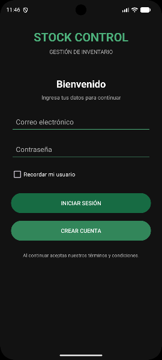
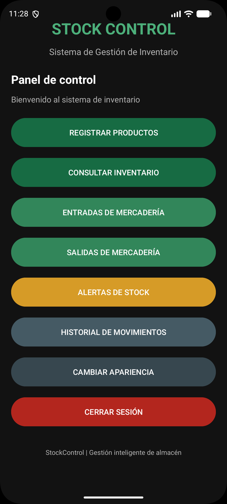
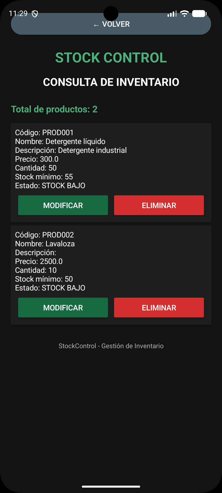
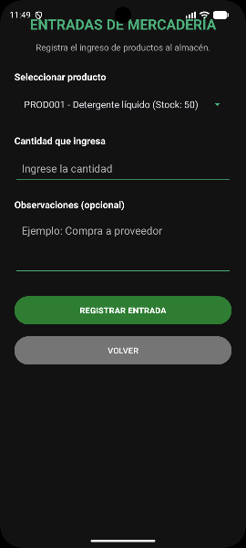
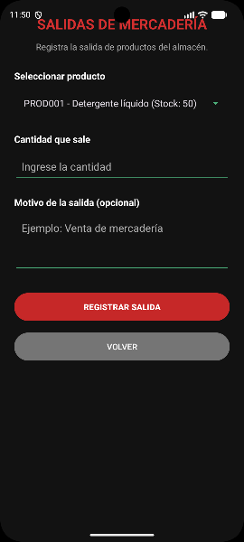
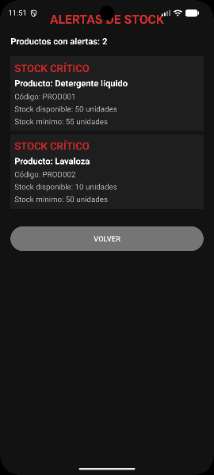
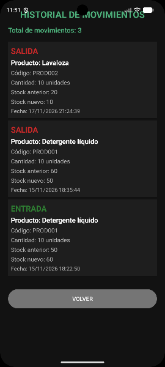

# 📦 StockControl
### Sistema de Gestión de Inventario de Almacén


## 📋 Descripción

StockControl es una aplicación móvil Android desarrollada para facilitar la administración y el control de inventarios de un almacén.

Permite registrar productos, controlar entradas y salidas de mercadería, consultar existencias, administrar usuarios y recibir alertas cuando los productos alcanzan su nivel mínimo de stock.

Cuenta con una interfaz intuitiva, almacenamiento local mediante SQLite y opciones de personalización visual.

## 🎯 Objetivo del proyecto

Desarrollar una aplicación móvil que permita gestionar eficientemente los productos y movimientos de inventario, manteniendo organizada y actualizada la información del almacén.

## 📱 Capturas de pantalla

### 1. Inicio de sesión



### 2. Menú principal



### 3. Consulta de inventario



### 4. Entradas de mercadería



### 5. Salidas de mercadería



### 6. Alertas de stock



### 7. Historial de movimientos



## 🚀 Funcionalidades principales

### 🔐 Usuarios
- Registro de usuarios.
- Inicio de sesión.
- Validación de credenciales.
- Cierre de sesión.

### 📦 Gestión de productos
- Registrar productos.
- Consultar inventario.
- Modificar productos.
- Eliminar productos.
- Consultar cantidades disponibles.
- Configurar stock mínimo.

### 📥 Entradas de mercadería
- Registrar entradas de productos.
- Actualizar automáticamente las existencias.
- Guardar los movimientos en el historial.

### 📤 Salidas de mercadería
- Registrar salidas de productos.
- Validar que exista stock suficiente.
- Actualizar automáticamente las existencias.
- Guardar los movimientos en el historial.

### ⚠️ Alertas de inventario
- Identificar productos con stock bajo.
- Detectar productos que alcanzan el stock mínimo.
- Mostrar alertas de stock crítico.

### 📊 Historial de movimientos
- Consultar entradas y salidas.
- Visualizar cantidades anteriores y nuevas.
- Consultar observaciones y fechas.

### 🎨 Apariencia
- Modo claro.
- Modo oscuro.
- Opción para seguir la configuración del dispositivo.

## 🛠️ Tecnologías utilizadas

| Tecnología | Utilización |
|---|---|
| Android Studio | Entorno de desarrollo |
| Kotlin | Lenguaje de programación |
| XML | Diseño de interfaces |
| SQLite | Base de datos local |
| Git | Control de versiones |
| GitHub | Almacenamiento del repositorio |

## 🗄️ Almacenamiento de datos

La aplicación utiliza SQLite para almacenar localmente:

- Usuarios.
- Productos.
- Movimientos de inventario.

Los datos permanecen almacenados aunque se cierre la aplicación.

## ⚙️ Instalación y ejecución

1. Clonar el repositorio desde GitHub.
2. Abrir Android Studio.
3. Seleccionar **Open**.
4. Buscar la carpeta del proyecto StockControl.
5. Esperar la sincronización de Gradle.
6. Ejecutar la aplicación en un emulador o dispositivo Android compatible.

## 📂 Estructura general del proyecto

```text
StockControl/
│
├── app/
│   └── src/
│       └── main/
│           ├── java/com/example/stockcontrol/
│           ├── res/
│           │   ├── layout/
│           │   ├── values/
│           │   └── values-night/
│           └── AndroidManifest.xml
│
├──## 📱 Capturas de pantalla

Las siguientes imágenes muestran las principales funcionalidades de StockControl.

### 1. Inicio de sesión


### 2. Menú principal


### 3. Consulta de inventario


### 4. Entradas de mercadería


### 5. Salidas de mercadería


### 6. Alertas de stock


### 7. Historial de movimientos

│
├── gradle/
├── build.gradle.kts
├── settings.gradle.kts
└── README.md
```

## 🔗 Repositorio en GitHub

[StockControl - GitHub](https://github.com/martin0800/StockControl)

## 👨‍💻 Información del proyecto

**Nombre:** StockControl  
**Tipo:** Aplicación móvil Android  
**Lenguaje principal:** Kotlin  
**Diseño:** XML  
**Base de datos:** SQLite  
**Entorno de desarrollo:** Android Studio

---

**StockControl | Gestión inteligente de almacén**